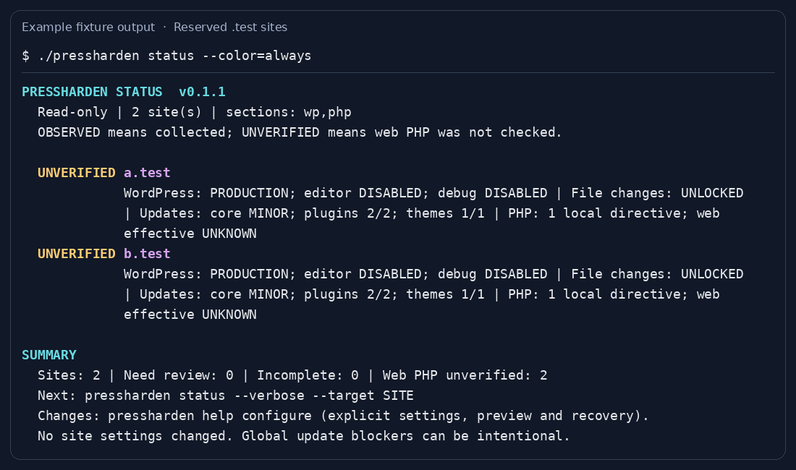

# PressHarden

<p align="center">
  
</p>

**Inspect WordPress and PHP policy, understand what needs review, and make deliberate configuration changes from the shell.** PressHarden covers file-modification controls, dashboard settings, automatic-update preferences, authentication salts, and supported local PHP settings across your local WordPress installations.

PressHarden is a standalone MIT-licensed Linux/Bash/PHP application. It contains its own discovery, targeting, lifecycle and relevant operation code. Neither sibling repository is required. It is not a wrapper around PressWarden.

**This guide describes PressHarden 0.1.2**, including combined `status`/`check`, area selectors, colored summaries, and grouped help. Read the [0.1.2 release notes](docs/releases/0.1.2.md) for the changes. Existing users can follow [Update and uninstall](#update-and-uninstall), then check `./pressharden version` and `./pressharden help`.

## Other Press tools

PressHarden is part of the **Press Tool Family**. Other standalone tools are available for related WordPress administration tasks:

- **[PressWarden](https://github.com/marketania/PressWarden)** — WordPress security auditing, malware and vulnerability detection, compromise investigation, integrity checks, and incident response.
- **[PressGarden](https://github.com/marketania/PressGarden)** — WordPress maintenance, database health, cleanup, caching, LiteSpeed management, and performance operations.

PressHarden owns desired-state configuration. Malware investigation, routine cleanup, cache management, and database maintenance remain with the relevant independent tools; none is a runtime dependency of another.

## Requirements

- Linux, Bash 4+, PHP CLI, GNU coreutils/find/tar, and a shell account that owns the selected sites. Use a currently security-supported, patched [PHP version](https://www.php.net/supported-versions.php); legacy PHP 7.4 syntax compatibility is retained for testing.
- WP-CLI (`wp`) and working WordPress/database access for WordPress policy inspection and changes. Static `status -php` and `php status` work without WP-CLI.
- `flock` for the shell transaction and per-site mutation locks. The PHP transaction engine uses PHP process support when available; the guarded shell fallback remains available where `proc_open` is disabled.
- `curl` for remote installation; the updater can use `curl` or `wget`. Local-source installation does not download another application.

Install outside website document roots, run as the site owner, and begin on a staging installation. The [public-readiness audit and rollout checklist](docs/PUBLIC-READINESS.md) describes the checks to complete before wider use.

## Install this distribution

### Recommended: install the exact source you reviewed

Download `PressHarden-0.1.2.tar.gz`, `SHA256SUMS`, and `SOURCE.json` from the [v0.1.2 release](https://github.com/marketania/PressHarden/releases/tag/v0.1.2). Verify the archive against the checksums, extract it, and review its source and `install.sh`. Other published [release assets](https://github.com/marketania/PressHarden/releases) have their own bundled help and release notes.

From the source directory:

```bash
PRESSHARDEN_INSTALL_SOURCE="$PWD" \
PRESSHARDEN_INSTALL_PREFIX="$HOME/tools/PressHarden" \
bash ./install.sh

cd "$HOME/tools/PressHarden"
./pressharden version
./pressharden help
```

This creates a separate portable installation with private configuration and state. The destination must not already exist. Keep the source checkout separate; an installed distribution uses the updater, while a Git checkout is maintained through Git.

For a user-wide executable symlink, set `PRESSHARDEN_INSTALL_MODE=user`. Its default program directory is `$HOME/.local/share/pressharden`, and its symlink is `$HOME/.local/bin/pressharden`; XDG settings and explicit install overrides can change those paths.

### Alternative: install the current `main` branch

Use only this tool's official installer. Download it into a separate directory, review it, and choose the installation prefix:

```bash
mkdir -p "$HOME/pressharden-download"
cd "$HOME/pressharden-download"
curl -fsSLo pressharden-install.sh https://raw.githubusercontent.com/marketania/PressHarden/main/install.sh
less ./pressharden-install.sh
PRESSHARDEN_INSTALL_PREFIX="$HOME/tools/PressHarden" bash ./pressharden-install.sh
```

Both the downloaded installer and its default source archive follow **moving `main`**. Use the local-source method above to install a specific release or reviewed tree. Installation validates source identity, archive layout, and syntax, and installs PressHarden alone.

## First run: choose a site before changing anything

The following commands inspect local installations and leave their settings unchanged. Replace the example root with your hosting account's site directory, then use a name printed by `sites`:

```bash
cd "$HOME/tools/PressHarden"
export PRESSHARDEN_SCAN_ROOT="/absolute/path/to/your/sites"
./pressharden config
./pressharden sites
./pressharden doctor --target example.com
./pressharden status --target example.com
```

`config` shows the resolved discovery root, configuration path, state path, and interaction mode. `sites` discovers WordPress directories without loading WordPress. `doctor` checks local dependencies and the selected installation count. A root with no eligible installations is incomplete, so correct discovery before continuing.

**Check the selected count.** A parent such as `example.com` includes discovered nested installations. If `sites` also lists `example.com/shop`, use that exact nested name or its absolute directory when that is the intended scope. A website name selects a local directory; it does not connect to a remote server.

For more detail, keep the same explicit target:

```bash
./pressharden status --verbose --target example.com
./pressharden status -php --target example.com
./pressharden help setup
```

WordPress status loads WordPress through WP-CLI with ordinary plugins, themes, and packages skipped. MU-plugins and early bootstrap code can still execute. Use static PHP inspection or an isolated copy when you do not trust the installation's code.



*Captured from actual `pressharden status --color=always` output using the repository's inert `.test` fixtures.*

## Everyday commands

| What you want to do | Command |
| --- | --- |
| Read the combined WordPress and local PHP overview | `./pressharden status --target example.com` |
| Inspect local PHP without WP-CLI | `./pressharden status -php --target example.com` |
| Check file-modification restrictions | `./pressharden check -locks --target example.com` |
| Read automatic-update preferences and blockers | `./pressharden status -updates --target example.com` |
| Show details for selected areas | `./pressharden status -php -locks --verbose --target example.com` |
| Compare the descriptive WordPress fleet baseline | `./pressharden wp-settings all` |
| Diagnose dependencies and discovery | `./pressharden doctor --target example.com` |
| Find change commands and the full reference | `./pressharden help configure` / `./pressharden help all` |

`check` is an alias for `status`. With no area selector, both WordPress and PHP are inspected. Selectors are additive, and `--verbose` respects the selected areas:

| Selector | Scope |
| --- | --- |
| `-wp` / `--wp` | WordPress policy, including file controls and update preferences |
| `-php` / `--php` | Static root `.user.ini` observations; verbose mode adds CLI values |
| `-updates` / `--updates` | Core/plugin/theme update preferences and known blockers |
| `-locks` / `--locks` | File-modification restriction |

Color is automatic when standard output is a terminal. Use `--color=always`, `--color=never`, or `--no-color`; `NO_COLOR` and `PRESSHARDEN_NOCOLOR` keep output plain. Automatic mode respects `TERM=dumb` and redirected output. Explicit `--color=always` overrides the terminal hint. Operation `--help` displays guidance without starting the operation.

## Understanding the results

| Label | Meaning |
| --- | --- |
| **OBSERVED** | The selected policy data was collected. This is not a security certification. |
| **REVIEW** | A supported check identified something to assess, such as production debugging, a repair endpoint, or blocked automatic updates. |
| **UNVERIFIED** | Local PHP information was read, but its effective web/FPM behavior has not been measured. |
| **INCOMPLETE** | Required data, discovery, or a requested detail view could not be read and validated. Resolve the error before relying on that view. |

Review messages are contextual. An update blocker can be an intentional deployment policy. An unlocked site is an observation, not automatically a vulnerability. The fleet baseline is the most common observed value, not a recommended security standard. Use the [WordPress policy reference](docs/WP-SETTINGS.md) and [automatic-update reference](docs/AUTO-UPDATES.md) to interpret individual fields.

### Exit codes

For `status` and `check`, **0** means the selected inspections completed with no flagged review items, **1** means review items, and **2** means incomplete/error. Unknown effective web PHP alone does not fail a completed static inspection. Review the printed summary before interpreting a nonzero exit as a failed command.

Other operations document their own outcomes: declined changes and PHP settings awaiting web verification can return 1; invalid requests or failed verification return 2. `lock-status` returns 2 when the configured restriction is absent or unreadable. A successful provider command establishes command completion, not independently measured service behavior.

## State and configuration

Set `PRESSHARDEN_SCAN_ROOT` explicitly for predictable scope. If it is omitted, discovery uses installation-mode and host-layout defaults; `config` shows the resolved root. Persist your chosen root in the configuration file that `config` reports. Explicitly exported `PRESSHARDEN_*` variables override saved values for one invocation or shell session.

| Installation mode | Configuration | State and reports | Cache |
| --- | --- | --- | --- |
| Portable | `config/config` beneath the installation | `var/`, including `var/reports/` | `var/cache/` |
| User-wide | `$HOME/.config/pressharden/config` | `$HOME/.local/state/pressharden/` | `$HOME/.cache/pressharden/` |

User-wide locations respect `XDG_CONFIG_HOME`, `XDG_STATE_HOME`, and `XDG_CACHE_HOME`. Explicit overrides are `PRESSHARDEN_CONFIG_FILE`, `PRESSHARDEN_STATE_DIR`, `PRESSHARDEN_CACHE_DIR`, and `PRESSHARDEN_REPORTS_DIR`.

Configuration is **trusted shell code**: keep it owner-controlled, mode 600, and outside served directories. Invalid syntax, unreadable configuration, and loading errors stop before an operation starts. `./pressharden config-new` previews missing template options without executing or editing the existing file. It does not apply a configuration migration automatically. See [config/config.example](config/config.example) for the supported options.

Use `PRESSHARDEN_DISCOVERY_DEPTH`, `PRESSHARDEN_EXCLUDE`, and optional `PRESSHARDEN_SITE_ALIASES_FILE` to describe your layout. [Website targeting and aliases](docs/SITE-TARGETS.md) explains the formats. Exclusions remain in force after narrowing a parent target.

For targeted commands, use one positional website/directory or `--target SITE`. **Omitting the target selects the configured fleet**, as does explicit `all`. Unknown, empty, duplicate, excluded, or ambiguous targets stop; they never fall back to all. Keep state and backups outside every selected WordPress root. Backups are not automatically pruned, and no `PRESSWARDEN_*` compatibility variables are consumed. `backups prune --older-than=DAYS` previews old recovery copies (wp-config transactions and per-category backups such as `php-policy`) and deletes nothing. `--apply` removes exactly the previewed set after confirmation. Only copies whose metadata records success are eligible, the newest copy per site and category is always kept, and each removal is logged to `state/backups/prune-log.tsv`.

## Make an explicit guarded change

First inspect the intended scope and decide the policy for that application. For example, to disable the WordPress dashboard file editor:

```bash
./pressharden wp-settings set editor disabled --target example.com
./pressharden status -wp --verbose --target example.com
```

The change asks for approval by default. Configuration transactions use private backups and staging, validate the proposed value and PHP syntax, recheck the original file, publish conditionally, and read back the result. If verification fails, rollback occurs only when it can preserve concurrent changes. See [configuration transactions and recovery](docs/CONFIG-TRANSACTIONS.md).

Other explicit commands include `lock`/`unlock`, supported `wp-settings set` policies, `auto-updates core|plugins|themes`, and `salts rotate auth|cache`. `lock` sets `DISALLOW_FILE_MODS`; it does not overwrite the separate editor preference. Automatic-update commands change preferences rather than immediately updating WordPress. Authentication salt rotation invalidates current login cookies/nonces; cache-salt rotation requires a compatible object-cache drop-in.

Recovery locations beneath the state directory are `config-transactions/` for configuration and salt changes, `backups/auto-updates/` for plugin/theme preferences, and `backups/php-policy/` for local PHP changes. Inspect the operation's reported location and metadata before recovery. Backups can contain secrets. Do not blindly copy an older config over a newer external change; [PHP policy and transaction safety](docs/PHP-POLICY-SAFETY.md) explains failure interpretation.

## PHP configuration: configured is not effective

`status -php` and `php status` read root `.user.ini` files as inert text. They do not bootstrap WordPress. WAF/autoload entries are identified for review without executing or disclosing their configured paths; the writer still refuses those files pending manual review. `php inspect` adds advanced runtime inspection, php.net lifecycle lookups, and optional hosting-provider comparisons. CLI values, local literals, and provider fields are distinct sources of information.

`php set DIRECTIVE VALUE [target]` supports a bounded allowlist of error, resource/upload, and native PHP session settings. First verify the actual web SAPI with your hosting environment. Only then, for example:

```bash
PRESSHARDEN_PHP_WEB_SAPI=fpm-fcgi ./pressharden php set display_errors Off --target example.com
```

The writer accepts verified-context `fpm-fcgi` or `cgi-fcgi` declarations, previews each site's change, and preserves a private recovery copy. That operator declaration is not a runtime measurement. System-only settings, complex values, and nondefault/disabled user-INI filenames can require hosting changes instead.

An on-disk PHP change returns **1 pending web verification**. Host overrides, nested configuration, cache delays, and differing web PHP versions still apply. PressHarden does not deploy a public phpinfo/probe file or claim that a local write proves effective web policy. Consult [PHP policy semantics and recovery](docs/PHP-POLICY-SAFETY.md).

## Troubleshooting

| Symptom | Next step |
| --- | --- |
| No sites, or the expected name is missing | Check `config`, set the intended root, inspect depth/exclusions, then rerun `sites`. For opaque layouts, use a local alias. |
| `doctor` reports missing WP-CLI | Make `wp` available to the same account. Static `status -php` remains available. |
| WordPress status is incomplete | Check `doctor --target SITE`, WordPress/database access, and the trusted runtime. Warnings or malformed provider output are not accepted as policy data. |
| Local PHP status is incomplete | Use `php status SITE` for the local refusal reason; inspect ownership, links, and `.user.ini` syntax before retrying. |
| Configuration syntax or loading error | Correct the named private config. `config-new` can show template additions without loading it. |
| Update/recovery lock remains | Follow [update recovery](docs/UPDATING.md); preserve the recovery workspace and inspect the failed operation before removing anything. |

## Safety and automation

Leave confirmation enabled while validating the first staging target. `PRESSHARDEN_INTERACTIVE=0` explicitly authorizes unattended changes; backups, scope checks, locks, and verification still apply. A failed site does not erase changes already completed on another site, so inspect partial results before retrying a fleet operation.

Stop competing administrative processes before updates or mutations. Locks coordinate PressHarden operations, not every hosting panel, deployment process, or sibling application. Use independent backups and test recovery. Suspected compromise calls for evidence preservation and investigation before policy changes.

## Update and uninstall

Finish other operations, then run these commands from your installed PressHarden directory:

```bash
./pressharden update
./pressharden version
./pressharden config-new
```

`update` defaults to the moving **`main` branch**. To select this release explicitly, use `PRESSHARDEN_REF=v0.1.2 ./pressharden update`. Git working trees refuse self-update by default; maintain reviewed checkouts through Git. `config-new` previews any missing configuration options for you to review.

`./pressharden update` targets `marketania/PressHarden`, never a sibling and never threat feeds. For isolated validation or recovery, test/update with a local validated distribution archive:

```bash
PRESSHARDEN_UPDATE_ARCHIVE=/absolute/path/PressHarden.tar.gz ./pressharden update
```

The updater preserves private configuration and state, validates product identity and source layout, and retains recovery data on failure. See [update and recovery details](docs/UPDATING.md), or run `./pressharden help update`.

`./uninstall.sh` confirms removal of managed program files and preserves saved configuration, backups, and state. `--yes` authorizes the noninteractive alternative; it does not purge private data.

## Development and provenance

For Codex/Claude coordination, review [GitHub collaboration](docs/GITHUB-COLLABORATION.md) and the current [handoff](docs/HANDOFF.md). Run `bash scripts/check.sh` for the local validation gate; `bash tests/run.sh` runs the benign-fixture suite. Live WordPress integration requires explicitly isolated test sites/databases, never production websites.

See [AI-assisted development](docs/AI-DEVELOPMENT.md) for repository workflow guidance. Trusted Codex projects default to GPT-6 Astra; the CLI itself has no OpenAI runtime dependency.

Separated from PressWarden 1.1.24 at `63adec182b4d3a20dbd5e24daa9b9fa0e98510b8`. See [provenance](PROVENANCE.md), [migration mapping](docs/MIGRATION.md), and [MIT license](LICENSE). PressWarden remains the security investigation tool; PressGarden handles routine maintenance and performance. Siblings are optional alternatives for other responsibilities, not dependencies.
